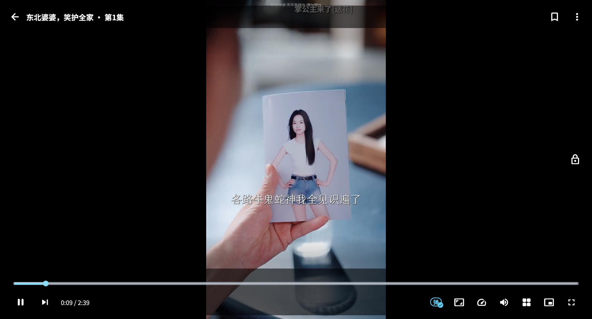
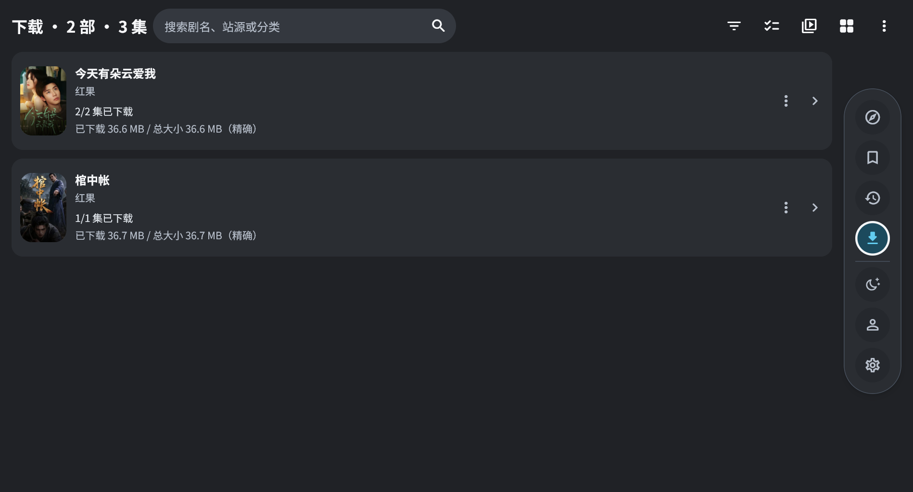
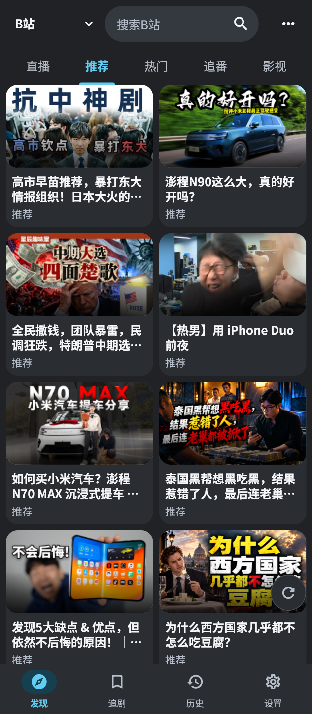
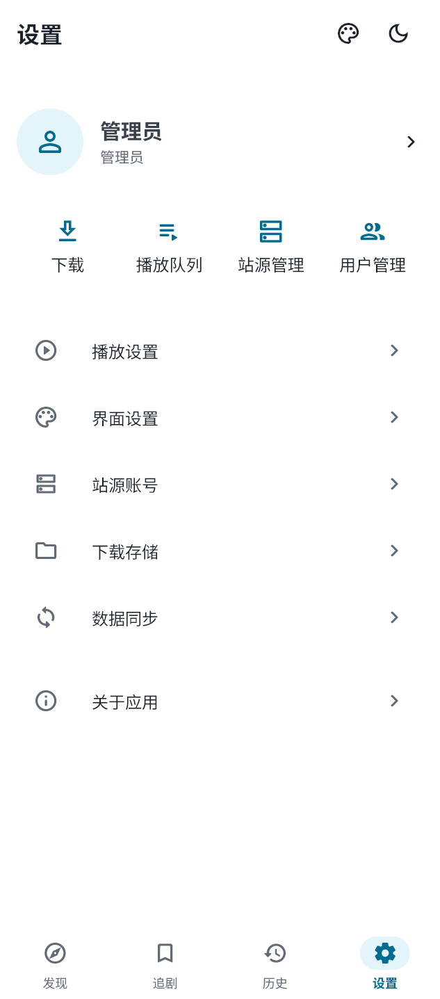

# 短剧汇 · 客户端下载

短剧汇是一款多端视频客户端，提供站源浏览、搜索、播放、追剧、观看历史与下载管理。Windows 客户端也可在局域网内向手机、平板的浏览器提供访问入口。

本仓库提供已发布客户端、功能说明与实际界面截图。安装文件位于 [Releases](https://github.com/Grails125/duanjuapp-releases/releases)。

## 下载

**推荐下载：0.1.1 · Windows x64 · 开发快照**

| 安装方式 | 下载 | 说明 |
| --- | --- | --- |
| 便携启动器 | [Windows x64 EXE](https://github.com/Grails125/duanjuapp-releases/releases/download/windows-v0.1.1/duanjuhui-0.1.1-windows-x64.exe) | 下载后运行，包含完整运行资源 |
| 完整运行目录 | [Windows x64 ZIP](https://github.com/Grails125/duanjuapp-releases/releases/download/windows-v0.1.1/duanjuhui-0.1.1-windows-x64.zip) | 全部解压后运行 `duanjuhui.exe`，保留 DLL、`data` 与其他资源 |
| 文件校验 | [SHA256SUMS.txt](https://github.com/Grails125/duanjuapp-releases/releases/download/windows-v0.1.1/SHA256SUMS.txt) | 核对下载文件是否完整 |
| 构建信息 | [BUILD_METADATA.json](https://github.com/Grails125/duanjuapp-releases/releases/download/windows-v0.1.1/BUILD_METADATA.json) | 查看版本、构建来源与文件摘要 |

需要其他版本时，请查看 [0.1.0](https://github.com/Grails125/duanjuapp-releases/releases/tag/windows-v0.1.0) 或[全部发布](https://github.com/Grails125/duanjuapp-releases/releases)。当前公开附件仅包含 Windows x64；Android、iOS 和其他架构暂无下载包。

## 功能

| 功能 | 使用说明 |
| --- | --- |
| 浏览与搜索 | 按站源及实际分类浏览内容，使用关键词搜索、联合搜索、筛选和排序；内置 B站、红果、影视、影视2、奈飞入口 |
| 应用内播放 | 查看详情、选集播放、切换实际可用的画质和线路，支持进度定位、倍速、音量、画面比例、全屏及 Windows 小窗 |
| 追剧与历史 | 管理想看、在看、已看等追剧状态，通过观看历史继续播放，支持搜索和批量管理 |
| 下载与离线 | 选择剧集和实际可下载画质，管理下载队列、暂停、继续、取消和重试，查看下载记录及本地媒体 |
| 字幕与弹幕 | 选择媒体提供的字幕或导入本地字幕；支持已适配站源的弹幕及显示、字号、密度等设置，具体能力随来源而异 |
| 局域网浏览器 | 在客户端开启网页访问，其他设备使用浏览器完成配对后访问；站源请求与媒体处理由主机客户端承担 |
| 主题与布局 | 浅色、深色主题及横竖布局；宽屏使用侧边导航，竖屏提供发现、追剧、历史、设置四个入口，下载位于设置中 |
| 播放诊断 | 查看媒体信息、缓冲和读取状态，并在更多诊断中查看当前播放请求地址；可获得的指标取决于平台和后端 |

可用内容与画质取决于来源实际返回结果，以及账号、会员、地区和媒体权限。客户端不提供内容授权，不绕过登录、付费或加密保护。

## 实际截图

以下为用户提供的实际客户端截图，依次展示宽屏首页、播放器、下载管理、深色竖屏、浅色竖屏与设置。保留原图，未作界面重绘、裁剪或效果合成；尺寸和文件摘要见[截图信息](screenshots/metadata.json)。

### 宽屏浏览

### 播放器

### 下载管理

### 竖屏与主题

<table>
  <tr>
    <th>深色竖屏</th>
    <th>浅色竖屏</th>
    <th>设置</th>
  </tr>
  <tr>
    <td></td>
    <td></td>
    <td></td>
  </tr>
</table>

## 开始使用

1. 下载 EXE，或将 ZIP 完整解压后启动客户端。
2. 在发现页选择站源，浏览分类或搜索内容；选择视频后查看详情、选集并播放。
3. 需要离线观看时，从内容菜单选择下载；竖屏可从设置进入下载管理。
4. 需要用其他设备的浏览器访问时，在设置的数据同步分类开启局域网页面，按客户端显示的地址与配对流程连接。主机客户端需保持运行。

此处提供的客户端采用本地构建，请从本仓库发布页手动下载更新。ZIP 中的 `data`、DLL 和其他资源属于运行所需文件，不要只复制其中的 EXE。

## 版本与验证

发布文件沿用已验证安装包，EXE 与 ZIP 的 SHA-256 保持一致；构建信息仅保留适合公开的版本、来源提交和文件摘要。

Windows 0.1.1 已通过包完整性、版本、更新协议、隔离冷／热启动及两种包的原生核心、媒体探测、转封装和本地合成视频播放检查。

客户端目前为开发快照。真实站源、不同显卡驱动与跨设备使用仍需进一步验证；移动浏览器的物理手势、软键盘和全屏效果取决于浏览器支持情况。截图展示界面，不作为这些场景已经通过验收的证明。

## 问题反馈

可在 [Issues](https://github.com/Grails125/duanjuapp-releases/issues) 反馈问题。请提供客户端版本、Windows 版本、操作步骤、预期结果和实际表现；涉及画面问题时可附截图。

提交前请移除账号、令牌、配对码、个人文件路径和带授权参数的播放地址。第三方组件的许可证随运行包提供。
